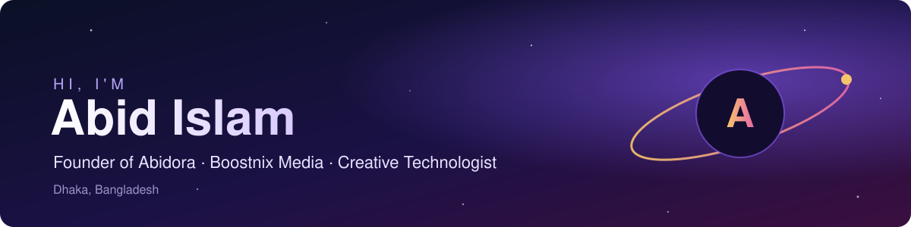

  

  <i>Exploring the possibilities of intelligence, technology and imagination to build what comes next.</i>

  <a href="https://abidora.boostnixmedia.com/"><b>🌌 Abidora</b></a> &nbsp;·&nbsp;
  <a href="https://boostnixmedia.com/"><b>💼 Boostnix Media</b></a> &nbsp;·&nbsp;
  <a href="https://www.linkedin.com/in/abid-islam-a926ab2b5/"><b>LinkedIn</b></a> &nbsp;·&nbsp;
  <a href="https://wa.me/8801775776473"><b>WhatsApp</b></a>

---

### 👋 About me

- 🚀 **Founder of [Abidora](https://abidora.boostnixmedia.com/)**, an immersive web universe of 3D worlds with its own AI assistant.
- 💼 **Founder of [Boostnix Media](https://boostnixmedia.com/)**, a digital marketing and web agency that builds websites and online shops for businesses in Bangladesh.
- 🎓 BBA student, 73rd batch, **Shanto-Mariam University of Creative Technology** (SMUCT).
- 📍 Based in **Dhaka, Bangladesh**. I build in **Bangla and English**, so websites work for customers in cities and villages alike.

### 🛠️ What I build

| Project | What it is | Built with | Live |
|---|---|---|---|
| 🌌 **[Abidora](https://github.com/abid2929/ABID-ORA)** | "A Universe Without Limits": immersive multi-world platform with 3D worlds, an AI assistant and 10 languages | Astro, TypeScript, Three.js, PHP | [Website](https://abidora.boostnixmedia.com/) |
| 👟 **[JUTAR BAZAR BD](https://github.com/abid2929/JUTAR-BAZAR)** | Bangla-first online shoe shop: cart, cash on delivery, order tracking, WhatsApp ordering, Bangla admin with AI auto captions | PHP 8, SQLite, JavaScript | [Demo](https://abid2929.github.io/JUTAR-BAZAR/) |
| 📈 **[Boostnix Media](https://github.com/abid2929/BOOSTNIX-MEDIA)** | Agency website with services, video showcase, orders and contact | HTML, CSS, JavaScript | [Demo](https://abid2929.github.io/BOOSTNIX-MEDIA/) |
| 🕌 **[Bashundhara Kazi Office](https://github.com/abid2929/BASHUNDHARA-KAZI-OFFICE-)** | Bilingual service website for a Kazi office in Dhaka, with gallery and admin | HTML, CSS, JavaScript, PHP | [Demo](https://abid2929.github.io/BASHUNDHARA-KAZI-OFFICE-/) |

### 🧰 Tools I work with

  <kbd>HTML5</kbd> <kbd>CSS3</kbd> <kbd>JavaScript</kbd> <kbd>TypeScript</kbd> <kbd>PHP</kbd> <kbd>SQLite</kbd> <kbd>MySQL</kbd>
  <kbd>Astro</kbd> <kbd>Three.js</kbd> <kbd>Google Gemini API</kbd> <kbd>cPanel</kbd> <kbd>Git &amp; GitHub</kbd>
  <kbd>Facebook Pixel</kbd> <kbd>Google Analytics 4</kbd> <kbd>SEO</kbd>

### 🔭 What I'm exploring

AI assistants that speak Bangla naturally · immersive 3D on the web · fast, phone-first websites for small businesses in Bangladesh · creative tools that anyone can use.

### 🤝 Let's connect

Need a website, an online shop or digital marketing for your business? Message me on WhatsApp or reach me through **[Boostnix Media](https://boostnixmedia.com/)**.

| | |
|---|---|
| 💬 **WhatsApp** | [Chat with me](https://wa.me/8801775776473) |
| 💼 **LinkedIn** | [abid-islam-a926ab2b5](https://www.linkedin.com/in/abid-islam-a926ab2b5/) |
| 📘 **Facebook** | [abidislaammm](https://www.facebook.com/abidislaammm) |
| 📸 **Instagram** | [@abid__islamm](https://www.instagram.com/abid__islamm) |
| 𝕏 **X (Twitter)** | [@AbidIslam129309](https://x.com/AbidIslam129309) |
| 🎵 **TikTok** | [@abid_shaa](https://www.tiktok.com/@abid_shaa) |
| 🌌 **Abidora** | [abidora.boostnixmedia.com](https://abidora.boostnixmedia.com/) |
| 🌐 **Boostnix Media** | [boostnixmedia.com](https://boostnixmedia.com/) |

Thanks for visiting ✨

