

  

  <i>Exploring the possibilities of intelligence, technology and imagination to build what comes next.</i>

  <a href="#live-websites"><b>🌐 Live websites</b></a> &nbsp;·&nbsp;
  <a href="#live-demos"><b>🚀 GitHub Pages demos</b></a> &nbsp;·&nbsp;
  <a href="https://www.linkedin.com/in/abid-islam-a926ab2b5/"><b>💼 LinkedIn</b></a> &nbsp;·&nbsp;
  <a href="https://wa.me/8801775776473"><b>💬 WhatsApp</b></a>

  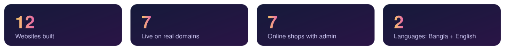

---

## 👋 About me

- 🚀 **Founder of [Abidora](https://abidora.boostnixmedia.com/)**, an immersive web universe of 3D worlds with its own AI assistant.
- 💼 **Working at [Boostnix Media](https://boostnixmedia.com/)**, a digital marketing and web agency that builds websites and online shops for businesses in Bangladesh.
- 🎓 BBA student, 73rd batch, **Shanto-Mariam University of Creative Technology** (SMUCT).
- 📍 Based in **Dhaka, Bangladesh**. I build in **Bangla and English**, so websites work for customers in cities and villages alike.
- ⚡ Every site I ship is **phone-first, fast and SEO-ready**, and every shop comes with an **easy Bangla admin panel** for the owner.

---

<table>
<tr>
<td width="50%" valign="top">

<h3>🌌 Abidora</h3>

&nbsp; abidora.boostnixmedia.com

"A Universe Without Limits": my own platform of immersive 3D worlds you can explore and play with, an AI assistant with voice, and 10 languages.

<kbd>Astro</kbd> <kbd>TypeScript</kbd> <kbd>Three.js</kbd> <kbd>PHP</kbd> <kbd>Gemini AI</kbd>

 

</td>
<td width="50%" valign="top">
<a href="https://boostnixmedia.com/">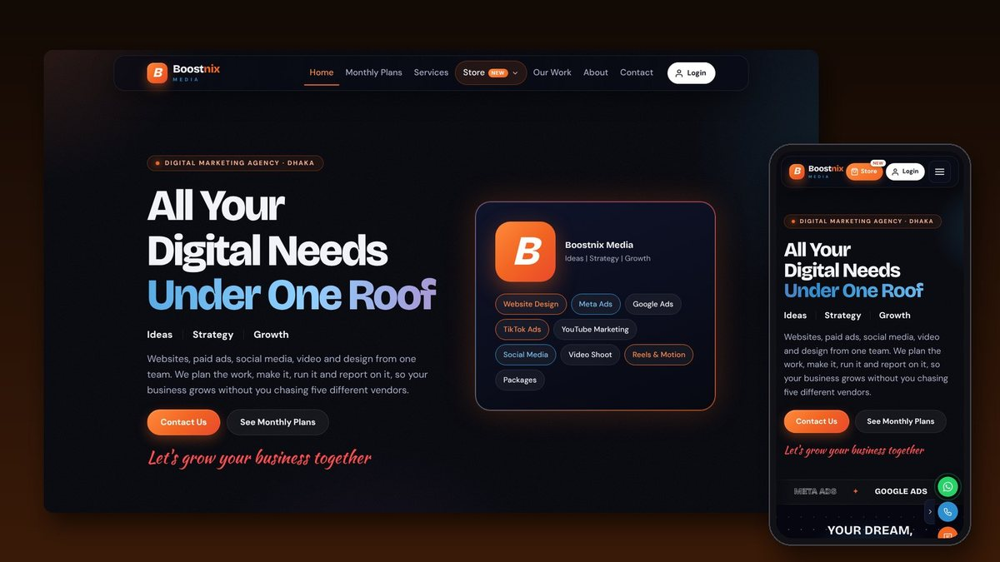</a>
<h3>📈 Boostnix Media</h3>

&nbsp; boostnixmedia.com

Digital marketing agency website: services, monthly plans, digital products store, video showcase, online orders and contact, with its own admin and tracking.

<kbd>HTML</kbd> <kbd>CSS</kbd> <kbd>JavaScript</kbd> <kbd>PHP</kbd> <kbd>GA4 + Pixel</kbd>

 

</td>
</tr>
<tr>
<td width="50%" valign="top">

<h3>💄 Loom &amp; Lustre</h3>

&nbsp; loomlustreshop.com

Premium fashion and beauty store: sarees, kurtis, western wear, men, kids, home decor, bags, jewellery and makeup, with department menus, flash sale countdown, wishlist and admin backup.

<kbd>PHP 8</kbd> <kbd>SQLite</kbd> <kbd>JavaScript</kbd>

 

</td>
<td width="50%" valign="top">
<a href="https://lifebdshop.com/">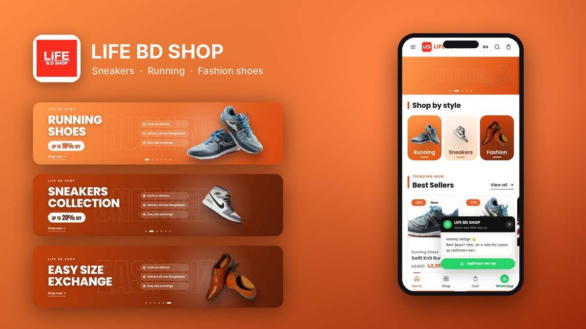</a>
<h3>🧡 Life BD Shop</h3>

&nbsp; lifebdshop.com

Orange and white sneaker shop, rebuilt from WordPress into a fast custom site: running, sneakers and fashion shoes, one-tap Order Now, cash on delivery and a Bangla admin panel.

<kbd>PHP 8</kbd> <kbd>SQLite</kbd> <kbd>JavaScript</kbd> <kbd>Admin panel</kbd>

</td>
</tr>
<tr>
<td width="50%" valign="top">
<a href="https://petversebd.com/">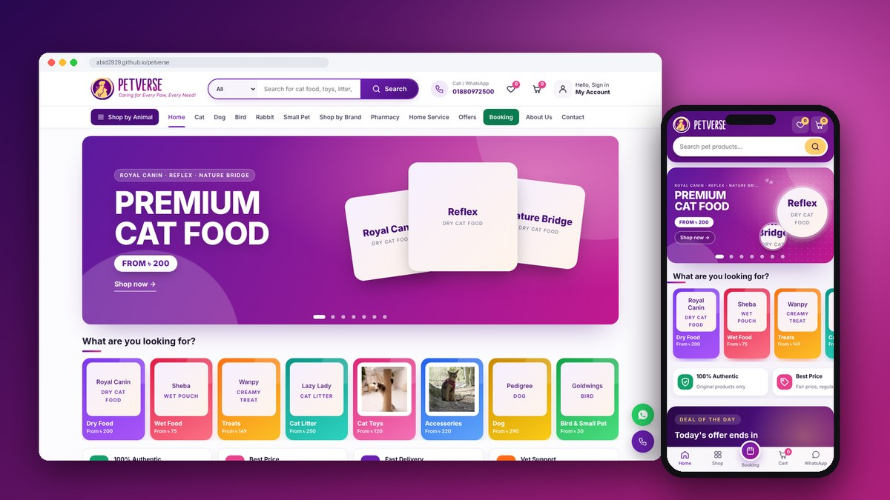</a>
<h3>🐾 PetVerse</h3>

&nbsp; petversebd.com

Pet shop and care for Bashundhara and Baridhara: food by brand, toys, pharmacy, deals of the day and home service booking, with its own English + Bangla admin and one-click backup.

<kbd>HTML</kbd> <kbd>JavaScript</kbd> <kbd>PHP</kbd> <kbd>JSON</kbd>

 

</td>
<td width="50%" valign="top">

<h3>🕌 Bashundhara Kazi Office</h3>

&nbsp; bashundharakaziofficebd.com

Bilingual (Bangla + English) service website for a Kazi office in Dhaka: services, photo gallery, videos, contact and a private admin panel.

<kbd>HTML</kbd> <kbd>CSS</kbd> <kbd>JavaScript</kbd> <kbd>PHP</kbd>

 

</td>
</tr>
<tr>
<td colspan="2" valign="top">
<a href="https://jutarbazarbd.com/">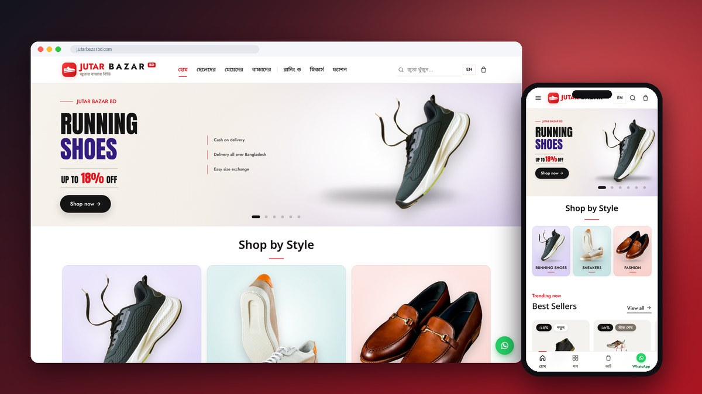</a>
<h3>👟 Jutar Bazar</h3>

&nbsp; jutarbazarbd.com

Bangla-first online shoe shop: light premium banners, style cards, cart, cash on delivery, order tracking and WhatsApp ordering. Bangla admin with sales chart and AI auto captions.

<kbd>PHP 8</kbd> <kbd>SQLite</kbd> <kbd>JavaScript</kbd> <kbd>Admin panel</kbd>

 

</td>
</tr>
</table>

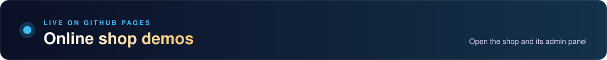

<table>
<tr>
<td colspan="2" valign="top">

<h3>🚌 Dhaka Bus Fare</h3>

&nbsp; abid2929.github.io/DHAKA-BUS-FARE

A free, app-style tool for Dhaka commuters, now with 4 separate pages: Fare finder, All routes, All stops and Bus companies. Type any two stops (Bangla, Banglish or with typos) and instantly get the official BRTA fare, the student fare, the distance and every stop on the way. On PC the trip is drawn on a map; on phone it works like a ride app with a bottom tab bar. Also: 113 routes, 300+ stops, 82 bus companies, one-change trip suggestions, dark mode and a Bangla helper bot.

<kbd>HTML</kbd> <kbd>CSS</kbd> <kbd>JavaScript</kbd> <kbd>BRTA fare data</kbd> <kbd>Bangla bot</kbd>

 

 

<b>📱 4 pages, tap one to open it:</b>

  <a href="https://abid2929.github.io/DHAKA-BUS-FARE/">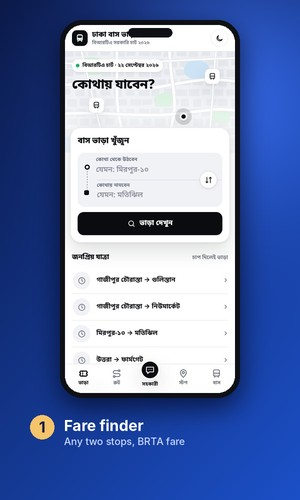</a>
  <a href="https://abid2929.github.io/DHAKA-BUS-FARE/routes.html">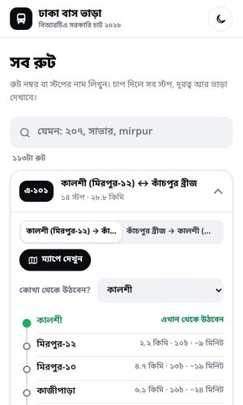</a>
  <a href="https://abid2929.github.io/DHAKA-BUS-FARE/stops.html">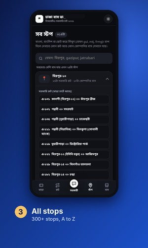</a>
  <a href="https://abid2929.github.io/DHAKA-BUS-FARE/buses.html">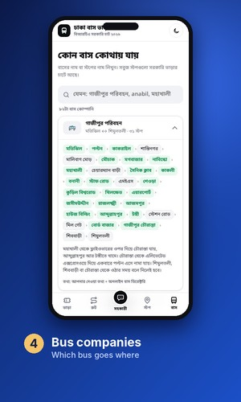</a>

</td>
</tr>
<tr>
<td width="50%" valign="top">

<h3>🎄 Christmas Gallery</h3>

&nbsp; abid2929.github.io/Christmas-Gallery

Red and gold Christmas decoration shop in Bangla with an English switch: trees, balls, lights, Santa showpieces, wreaths and gifts, with WhatsApp ordering.

<kbd>HTML</kbd> <kbd>JavaScript</kbd> <kbd>PHP</kbd> <kbd>JSON</kbd>

  

</td>
<td width="50%" valign="top">
<a href="https://abid2929.github.io/ELITE-SMART-HUB/">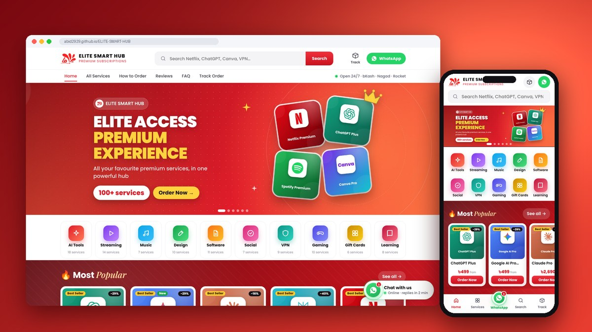</a>
<h3>👑 Elite Smart Hub</h3>

&nbsp; abid2929.github.io/ELITE-SMART-HUB

Red and white shop for 100+ digital subscriptions (ChatGPT, Gemini, Claude, Netflix, Spotify, Canva, VPN): instant search, 10 category shortcuts, a page for every product, bKash / Nagad / Rocket and a 5-tab phone bar.

<kbd>HTML</kbd> <kbd>JavaScript</kbd> <kbd>PHP</kbd> <kbd>JSON</kbd>

  

</td>
</tr>
</table>

<table>
<tr>
<td colspan="2" valign="top">
<a href="https://social.boostnixmedia.com/">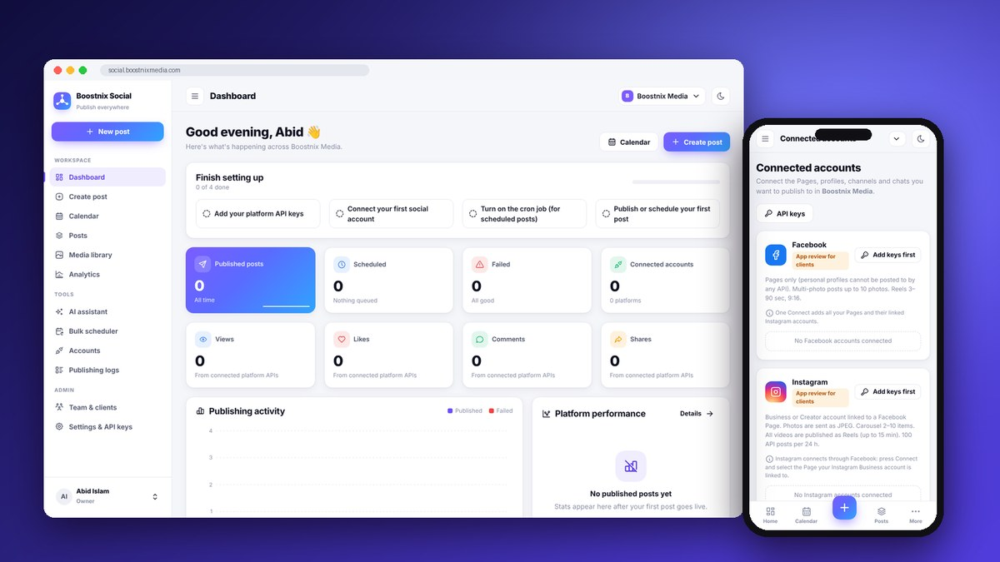</a>
<h3>📣 Boostnix Social</h3>

🔗 social.boostnixmedia.com

Social media publishing platform: write once and post or schedule to Facebook, Instagram, YouTube, TikTok, X, Threads, LinkedIn, Pinterest, Telegram and WhatsApp, with a calendar, bulk scheduler, analytics and an AI assistant.

<kbd>PHP 8</kbd> <kbd>SQLite</kbd> <kbd>Cron</kbd> <kbd>Official APIs</kbd> <kbd>Gemini AI</kbd>

</td>
</tr>
</table>

Every shop comes with an easy admin panel I designed, in Bangla and English: products, orders, banners, reviews, delivery charges, staff roles and backups, all from a phone.

  

---

## 🧰 Tools I work with

  

## 🔭 What I'm exploring

AI assistants that speak Bangla naturally · immersive 3D on the web · fast, phone-first websites for small businesses in Bangladesh · creative tools that anyone can use.

---

## 🤝 Let's connect

Need a website, an online shop or digital marketing for your business? Message me on WhatsApp or LinkedIn.

  &nbsp;
  &nbsp;
  &nbsp;
  &nbsp;

  &nbsp;
  &nbsp;
  &nbsp;
  &nbsp;

Thanks for visiting ✨ · Made with care in Dhaka, Bangladesh

