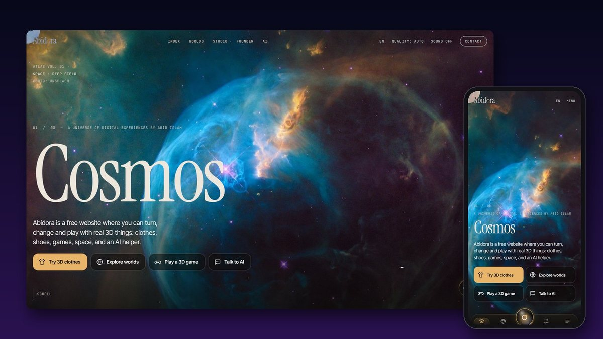
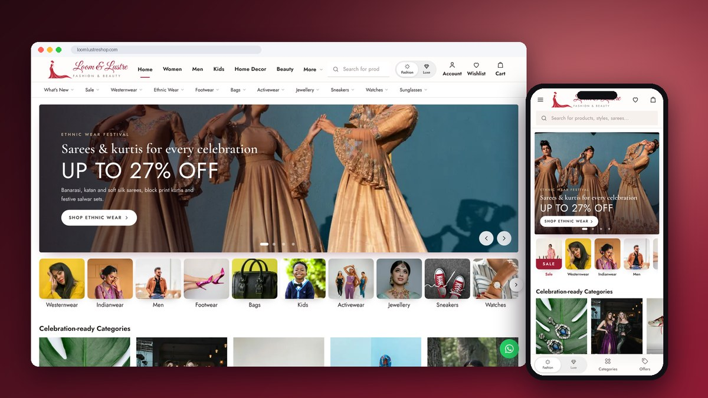

  

  <i>Exploring the possibilities of intelligence, technology and imagination to build what comes next.</i>

  <a href="#-live-websites"><b>🌐 Live websites</b></a> &nbsp;·&nbsp;
  <a href="#-online-shops-on-github-pages"><b>🛍️ Online shops</b></a> &nbsp;·&nbsp;
  <a href="https://www.linkedin.com/in/abid-islam-a926ab2b5/"><b>💼 LinkedIn</b></a> &nbsp;·&nbsp;
  <a href="https://wa.me/8801775776473"><b>💬 WhatsApp</b></a>

  <kbd>&nbsp;8 websites built&nbsp;</kbd> &nbsp;
  <kbd>&nbsp;5 live on real domains&nbsp;</kbd> &nbsp;
  <kbd>&nbsp;4 online shops with admin panel&nbsp;</kbd> &nbsp;
  <kbd>&nbsp;Bangla + English&nbsp;</kbd>

---

## 👋 About me

- 🚀 **Founder of [Abidora](https://abidora.boostnixmedia.com/)**, an immersive web universe of 3D worlds with its own AI assistant.
- 💼 **Working at [Boostnix Media](https://boostnixmedia.com/)**, a digital marketing and web agency that builds websites and online shops for businesses in Bangladesh.
- 🎓 BBA student, 73rd batch, **Shanto-Mariam University of Creative Technology** (SMUCT).
- 📍 Based in **Dhaka, Bangladesh**. I build in **Bangla and English**, so websites work for customers in cities and villages alike.
- ⚡ Every site I ship is **phone-first, fast and SEO-ready**, and every shop comes with an **easy Bangla admin panel** for the owner.

---

## 🌐 Live websites

<table>
<tr>
<td width="50%" valign="top">

<h3>🌌 Abidora</h3>

"A Universe Without Limits": an immersive platform of 3D worlds you can explore and play with, an AI assistant with voice, and 10 languages.

<kbd>Astro</kbd> <kbd>TypeScript</kbd> <kbd>Three.js</kbd> <kbd>PHP</kbd> <kbd>Gemini AI</kbd>

🔗 <a href="https://abidora.boostnixmedia.com/"><b>abidora.boostnixmedia.com</b></a> &nbsp;·&nbsp; <a href="https://github.com/abid2929/ABID-ORA">Code</a>

</td>
<td width="50%" valign="top">

<h3>📈 Boostnix Media</h3>

Digital marketing agency website: services, monthly plans, digital products store, video showcase, online orders and contact, with its own admin and tracking.

<kbd>HTML</kbd> <kbd>CSS</kbd> <kbd>JavaScript</kbd> <kbd>PHP</kbd> <kbd>GA4 + Pixel</kbd>

🔗 <a href="https://boostnixmedia.com/"><b>boostnixmedia.com</b></a> &nbsp;·&nbsp; <a href="https://github.com/abid2929/BOOSTNIX-MEDIA">Code</a>

</td>
</tr>
<tr>
<td width="50%" valign="top">

<h3>🕌 Bashundhara Kazi Office</h3>

Bilingual (Bangla + English) service website for a Kazi office in Dhaka: services, photo gallery, videos, contact and a private admin panel.

<kbd>HTML</kbd> <kbd>CSS</kbd> <kbd>JavaScript</kbd> <kbd>PHP</kbd>

🔗 <a href="https://bashundharakaziofficebd.com/"><b>bashundharakaziofficebd.com</b></a> &nbsp;·&nbsp; <a href="https://github.com/abid2929/BASHUNDHARA-KAZI-OFFICE-">Code</a>

</td>
<td width="50%" valign="top">

<h3>👟 Jutar Bazar</h3>

Bangla-first online shoe shop: product slider, categories, cart, cash on delivery, order tracking and WhatsApp ordering. Bangla admin with sales chart and AI auto captions.

<kbd>PHP 8</kbd> <kbd>SQLite</kbd> <kbd>JavaScript</kbd> <kbd>Admin panel</kbd>

🔗 <a href="https://jutarbazarbd.com/"><b>jutarbazarbd.com</b></a> &nbsp;·&nbsp; <a href="https://github.com/abid2929/JUTAR-BAZAR">Code</a>

</td>
</tr>
<tr>
<td width="50%" valign="top">

<h3>🚌 Dhaka Bus Fare</h3>

Type any two stops and see which bus routes go there, the official BRTA fare, student fare and distance. Includes a Bangla helper bot for questions.

<kbd>HTML</kbd> <kbd>CSS</kbd> <kbd>JavaScript</kbd> <kbd>BRTA data</kbd>

🔗 <a href="https://boostnixmedia.com/bus/"><b>boostnixmedia.com/bus</b></a>

</td>
<td width="50%" valign="top">
<h3>💡 Need a website like these?</h3>

I build fast, beautiful websites and online shops for businesses in Bangladesh, in Bangla and English, with an easy admin panel you can run from your phone.

✅ Online shop with cart and cash on delivery 
✅ Bangla admin panel for products, orders and banners 
✅ WhatsApp ordering and Facebook Pixel 
✅ SEO, fast loading and phone-first design

💬 <a href="https://wa.me/8801775776473"><b>Message me on WhatsApp</b></a>

</td>
</tr>
</table>

---

## 🛍️ Online shops on GitHub Pages

<table>
<tr>
<td width="33%" valign="top">

<h3>🐾 PetVerse</h3>

Pet shop for Bangladesh: cat and dog food, toys, pharmacy, shop by brand and home service booking.

<kbd>HTML</kbd> <kbd>JavaScript</kbd> <kbd>PHP</kbd> <kbd>JSON</kbd>

🔗 <a href="https://abid2929.github.io/petverse/"><b>Visit shop</b></a> · <a href="https://abid2929.github.io/petverse/admin/">Admin demo</a> · <a href="https://github.com/abid2929/petverse">Code</a>

</td>
<td width="33%" valign="top">

<h3>🎄 Christmas Gallery</h3>

Red and gold Christmas decoration shop, in Bangla with an English switch: trees, lights, gifts and WhatsApp ordering.

<kbd>HTML</kbd> <kbd>JavaScript</kbd> <kbd>PHP</kbd> <kbd>JSON</kbd>

🔗 <a href="https://abid2929.github.io/Christmas-Gallery/"><b>Visit shop</b></a> · <a href="https://abid2929.github.io/Christmas-Gallery/admin/">Admin demo</a> · <a href="https://github.com/abid2929/Christmas-Gallery">Code</a>

</td>
<td width="33%" valign="top">

<h3>💄 Loom &amp; Lustre</h3>

Premium fashion and beauty shop: lips, skincare, makeup and fragrance, with flash sale countdown and wishlist.

<kbd>PHP 8</kbd> <kbd>SQLite</kbd> <kbd>JavaScript</kbd>

🔗 <a href="https://abid2929.github.io/Loom-Lustre/"><b>Visit shop</b></a> · <a href="https://abid2929.github.io/Loom-Lustre/admin/">Admin demo</a> · <a href="https://github.com/abid2929/Loom-Lustre">Code</a>

</td>
</tr>
</table>

All four shops share one admin panel I designed: Bangla by default with an English button, for products, orders, banners, reviews, delivery charges and staff roles.

---

## 🧰 Tools I work with

  <kbd>HTML5</kbd> <kbd>CSS3</kbd> <kbd>JavaScript</kbd> <kbd>TypeScript</kbd> <kbd>PHP 8</kbd> <kbd>SQLite</kbd> <kbd>MySQL</kbd>
  <kbd>Astro</kbd> <kbd>Three.js</kbd> <kbd>GSAP</kbd> <kbd>Google Gemini API</kbd>

  <kbd>cPanel</kbd> <kbd>GitHub Pages</kbd> <kbd>Git &amp; GitHub</kbd> <kbd>Facebook Pixel</kbd> <kbd>Google Analytics 4</kbd> <kbd>SEO</kbd> <kbd>Lighthouse</kbd>

## 🔭 What I'm exploring

AI assistants that speak Bangla naturally · immersive 3D on the web · fast, phone-first websites for small businesses in Bangladesh · creative tools that anyone can use.

---

## 🤝 Let's connect

Need a website, an online shop or digital marketing for your business? Message me on WhatsApp or LinkedIn.

<table>
<tr>
<td align="center" width="25%">💬 <a href="https://wa.me/8801775776473"><b>WhatsApp</b></a></td>
<td align="center" width="25%">💼 <a href="https://www.linkedin.com/in/abid-islam-a926ab2b5/"><b>LinkedIn</b></a></td>
<td align="center" width="25%">📘 <a href="https://www.facebook.com/abidislaammm"><b>Facebook</b></a></td>
<td align="center" width="25%">📸 <a href="https://www.instagram.com/abid__islamm"><b>Instagram</b></a></td>
</tr>
<tr>
<td align="center">𝕏 <a href="https://x.com/AbidIslam129309"><b>X (Twitter)</b></a></td>
<td align="center">🎵 <a href="https://www.tiktok.com/@abid_shaa"><b>TikTok</b></a></td>
<td align="center">🌌 <a href="https://abidora.boostnixmedia.com/"><b>Abidora</b></a></td>
<td align="center">🌐 <a href="https://boostnixmedia.com/"><b>Boostnix Media</b></a></td>
</tr>
</table>

Thanks for visiting ✨ · Made with care in Dhaka, Bangladesh

