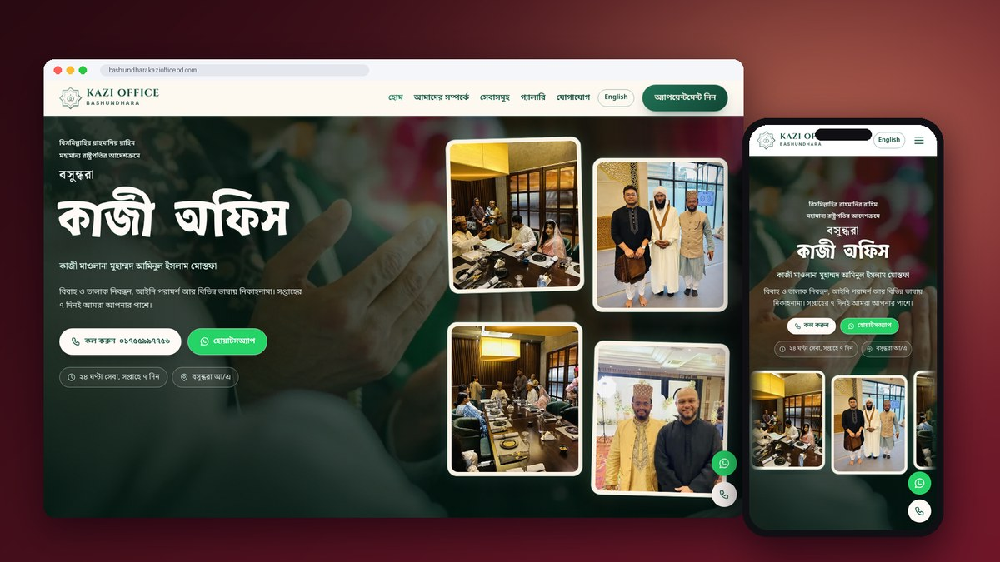
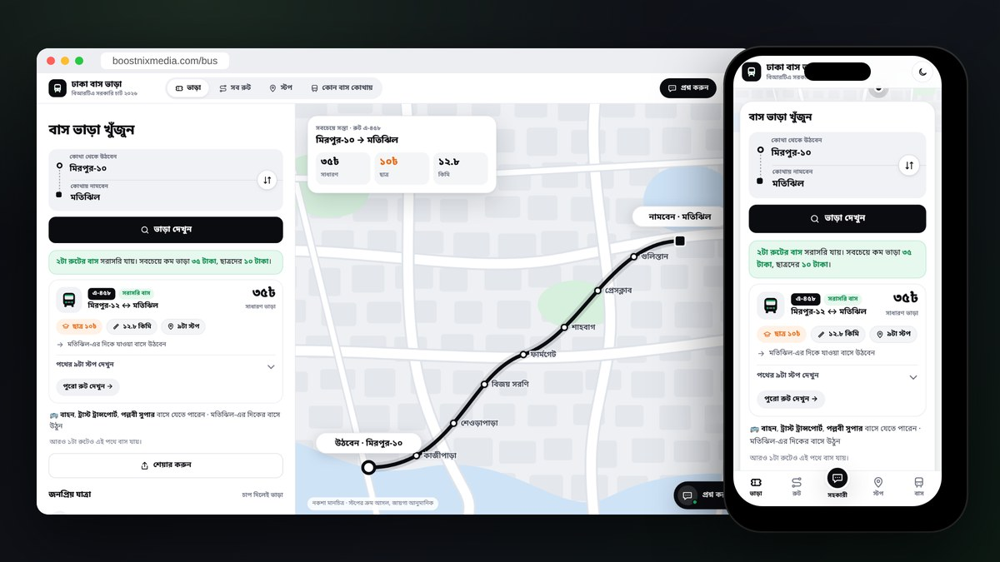
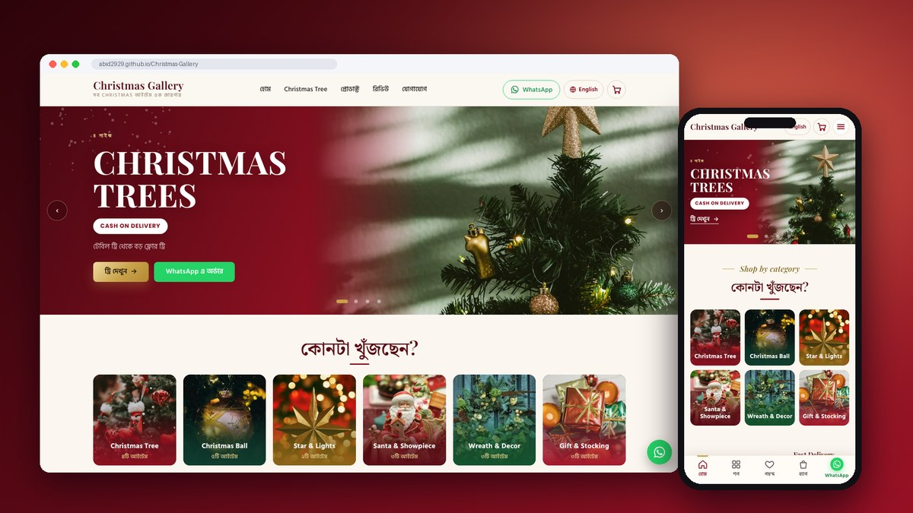
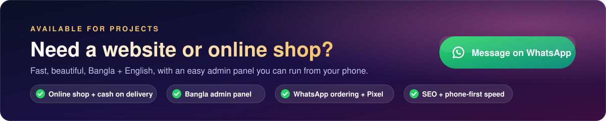

  

  <i>Exploring the possibilities of intelligence, technology and imagination to build what comes next.</i>

  <a href="#-live-websites"><b>🌐 Live websites</b></a> &nbsp;·&nbsp;
  <a href="#-live-demos-on-github-pages"><b>🚀 Live demos</b></a> &nbsp;·&nbsp;
  <a href="https://www.linkedin.com/in/abid-islam-a926ab2b5/"><b>💼 LinkedIn</b></a> &nbsp;·&nbsp;
  <a href="https://wa.me/8801775776473"><b>💬 WhatsApp</b></a>

  

---

## 👋 About me

- 🚀 **Founder of [Abidora](https://abidora.boostnixmedia.com/)**, an immersive web universe of 3D worlds with its own AI assistant.
- 💼 **Working at [Boostnix Media](https://boostnixmedia.com/)**, a digital marketing and web agency that builds websites and online shops for businesses in Bangladesh.
- 🎓 BBA student, 73rd batch, **Shanto-Mariam University of Creative Technology** (SMUCT).
- 📍 Based in **Dhaka, Bangladesh**. I build in **Bangla and English**, so websites work for customers in cities and villages alike.
- ⚡ Every site I ship is **phone-first, fast and SEO-ready**, and every shop comes with an **easy Bangla admin panel** for the owner.

---

## 🌐 Live websites

<table>
<tr>
<td width="50%" valign="top">

<h3>🌌 Abidora</h3>

"A Universe Without Limits": an immersive platform of 3D worlds you can explore and play with, an AI assistant with voice, and 10 languages.

<kbd>Astro</kbd> <kbd>TypeScript</kbd> <kbd>Three.js</kbd> <kbd>PHP</kbd> <kbd>Gemini AI</kbd>

🔗 <a href="https://abidora.boostnixmedia.com/"><b>abidora.boostnixmedia.com</b></a> &nbsp;·&nbsp; <a href="https://github.com/abid2929/ABID-ORA">Code</a>

</td>
<td width="50%" valign="top">

<h3>📈 Boostnix Media</h3>

Digital marketing agency website: services, monthly plans, digital products store, video showcase, online orders and contact, with its own admin and tracking.

<kbd>HTML</kbd> <kbd>CSS</kbd> <kbd>JavaScript</kbd> <kbd>PHP</kbd> <kbd>GA4 + Pixel</kbd>

🔗 <a href="https://boostnixmedia.com/"><b>boostnixmedia.com</b></a> &nbsp;·&nbsp; <a href="https://github.com/abid2929/BOOSTNIX-MEDIA">Code</a>

</td>
</tr>
<tr>
<td width="50%" valign="top">

<h3>🕌 Bashundhara Kazi Office</h3>

Bilingual (Bangla + English) service website for a Kazi office in Dhaka: services, photo gallery, videos, contact and a private admin panel.

<kbd>HTML</kbd> <kbd>CSS</kbd> <kbd>JavaScript</kbd> <kbd>PHP</kbd>

🔗 <a href="https://bashundharakaziofficebd.com/"><b>bashundharakaziofficebd.com</b></a> &nbsp;·&nbsp; <a href="https://github.com/abid2929/BASHUNDHARA-KAZI-OFFICE-">Code</a>

</td>
<td width="50%" valign="top">

<h3>👟 Jutar Bazar</h3>

Bangla-first online shoe shop: product slider, categories, cart, cash on delivery, order tracking and WhatsApp ordering. Bangla admin with sales chart and AI auto captions.

<kbd>PHP 8</kbd> <kbd>SQLite</kbd> <kbd>JavaScript</kbd> <kbd>Admin panel</kbd>

🔗 <a href="https://jutarbazarbd.com/"><b>jutarbazarbd.com</b></a> &nbsp;·&nbsp; <a href="https://github.com/abid2929/JUTAR-BAZAR">Code</a>

</td>
</tr>
<tr>
<td colspan="2" valign="top">

<h3>🧡 Life BD Shop <kbd>NEW</kbd></h3>

Orange and white sneaker shop, rebuilt from WordPress into a fast custom site: running, sneakers and fashion shoes, one-tap Order Now, cash on delivery and WhatsApp chat, with a Bangla admin panel for the owner.

<kbd>PHP 8</kbd> <kbd>SQLite</kbd> <kbd>JavaScript</kbd> <kbd>Admin panel</kbd>

🔗 <a href="https://lifebdshop.com/"><b>lifebdshop.com</b></a> &nbsp;·&nbsp; <a href="https://github.com/abid2929/LIFEBDSHOP">Code</a>

</td>
</tr>
</table>

---

## 🚀 Live demos on GitHub Pages

<table>
<tr>
<td colspan="3" valign="top">

<h3>🚌 Dhaka Bus Fare <kbd>NEW DESIGN</kbd></h3>

A free, app-style tool for Dhaka commuters. Type any two stops (Bangla, Banglish or with typos) and instantly get the official BRTA fare, the student fare, the distance and every stop on the way. On PC the trip is drawn on a map; on phone it works like a ride app with a bottom tab bar. Also: 113 routes, 300+ stops, 82 bus companies, one-change trip suggestions, dark mode and a Bangla helper bot.

<kbd>HTML</kbd> <kbd>CSS</kbd> <kbd>JavaScript</kbd> <kbd>BRTA fare data</kbd> <kbd>Bangla bot</kbd>

🔗 <a href="https://abid2929.github.io/DHAKA-BUS-FARE/"><b>Open demo</b></a> · <a href="https://boostnixmedia.com/bus/">Live site</a> · <a href="https://github.com/abid2929/DHAKA-BUS-FARE">Code</a>

</td>
</tr>
<tr>
<td width="33%" valign="top">

<h3>🐾 PetVerse</h3>

Pet shop for Bangladesh: cat and dog food, toys, pharmacy, shop by brand and home service booking.

<kbd>HTML</kbd> <kbd>JavaScript</kbd> <kbd>PHP</kbd> <kbd>JSON</kbd>

🔗 <a href="https://abid2929.github.io/petverse/"><b>Visit shop</b></a> · <a href="https://abid2929.github.io/petverse/admin/">Admin demo</a> · <a href="https://github.com/abid2929/petverse">Code</a>

</td>
<td width="33%" valign="top">

<h3>🎄 Christmas Gallery</h3>

Red and gold Christmas decoration shop, in Bangla with an English switch: trees, lights, gifts and WhatsApp ordering.

<kbd>HTML</kbd> <kbd>JavaScript</kbd> <kbd>PHP</kbd> <kbd>JSON</kbd>

🔗 <a href="https://abid2929.github.io/Christmas-Gallery/"><b>Visit shop</b></a> · <a href="https://abid2929.github.io/Christmas-Gallery/admin/">Admin demo</a> · <a href="https://github.com/abid2929/Christmas-Gallery">Code</a>

</td>
<td width="33%" valign="top">

<h3>💄 Loom &amp; Lustre</h3>

Premium fashion and beauty shop: lips, skincare, makeup and fragrance, with flash sale countdown and wishlist.

<kbd>PHP 8</kbd> <kbd>SQLite</kbd> <kbd>JavaScript</kbd>

🔗 <a href="https://abid2929.github.io/Loom-Lustre/"><b>Visit shop</b></a> · <a href="https://abid2929.github.io/Loom-Lustre/admin/">Admin demo</a> · <a href="https://github.com/abid2929/Loom-Lustre">Code</a>

</td>
</tr>
</table>

All my shops share one admin panel I designed: Bangla by default with an English button, for products, orders, banners, reviews, delivery charges and staff roles.

  

---

## 🧰 Tools I work with

  

## 🔭 What I'm exploring

AI assistants that speak Bangla naturally · immersive 3D on the web · fast, phone-first websites for small businesses in Bangladesh · creative tools that anyone can use.

---

## 🤝 Let's connect

Need a website, an online shop or digital marketing for your business? Message me on WhatsApp or LinkedIn.

  &nbsp;
  &nbsp;
  &nbsp;
  &nbsp;

  &nbsp;
  &nbsp;
  &nbsp;
  &nbsp;

Thanks for visiting ✨ · Made with care in Dhaka, Bangladesh

